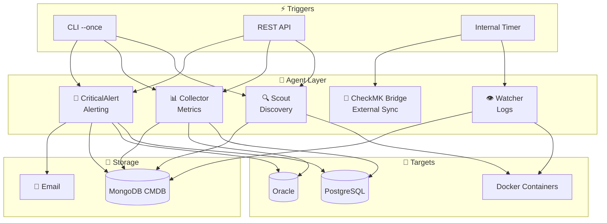
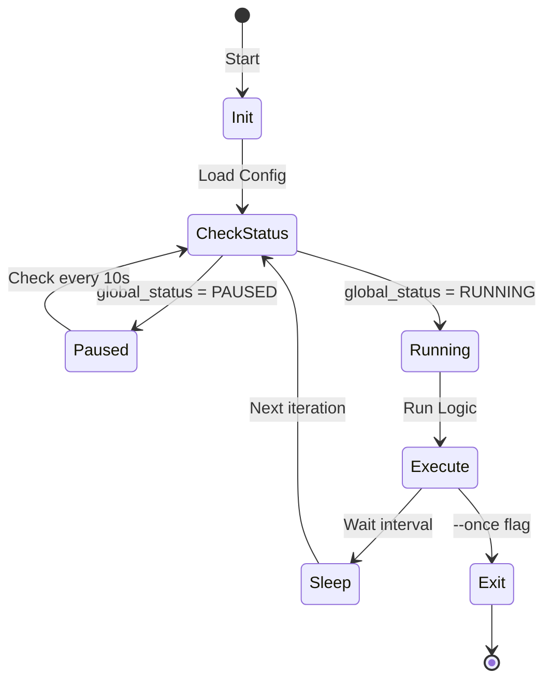

# 🤖 Agents

> Background workers for database discovery, monitoring, and alerting.

---

## 🎯 AI Context

```yaml
Purpose: Autonomous background workers that manage the database lifecycle
Location: Agents/
Key Files: Scout/main.py, Collector/main.py, CriticalAlert/main.py
Trigger: CLI (--once) or API endpoints
Output: MongoDB collections (inventory_databases, monitoring_alerts)
```

---

## 🏗️ Agent Architecture



---

## 📋 Agent Reference

| Agent | Purpose | Interval Key | API Trigger |
|-------|---------|--------------|-------------|
| **Scout** | Auto-discovery | `scout_interval` | `POST /api/auto-discovery` |
| **Collector** | Metrics | `collector_interval` | `POST /api/action/collect` |
| **Watcher** | Log monitoring | `watcher_interval` | N/A |
| **CriticalAlert** | Availability | `criticalalert_interval` | `POST /api/action/check` |
| **CheckMK Bridge** | External sync | `checkmk_bridge_interval` | N/A |

---

## 🔄 Agent Lifecycle



---

## 🛠️ Commands

```powershell
# One-shot mode (for testing)
python Agents/Scout/main.py --once
python Agents/Collector/main.py --once
python Agents/CriticalAlert/main.py --once --email dba@example.com

# Continuous mode (uses interval from MongoDB)
python Agents/Scout/main.py
```

---

## ⚙️ Configuration

Intervals stored in MongoDB `system_config`:

```javascript
// View intervals
db.system_config.find({key: {$regex: /interval/}})

// Update interval (seconds)
db.system_config.updateOne(
  {key: "scout_interval"},
  {$set: {value: 60}}
)
```

Or via API:
```bash
curl -X POST http://localhost:9000/api/config \
  -H "Content-Type: application/json" \
  -d '{"scout_interval": 30}'
```

---

## 📁 Structure

```
Agents/
├── Scout/              # Database discovery
│   ├── main.py         # Entry point
│   └── user_provisioner.py
├── Collector/          # Metrics collection
│   ├── main.py
│   ├── pg_collector.py
│   └── oracle_collector.py
├── Watcher/            # Log monitoring
│   ├── main.py
│   └── ai_analyzer.py  # Forensic analysis
├── CriticalAlert/      # Alerting
│   └── main.py
├── CheckMK_Bridge/     # External integration
│   └── main.py
├── AIAssistant/        # Chat tools
│   └── tools/
└── DailyAudit/         # Scheduled reports
    └── main.py
```

---

## 🔗 Related

- [directives/database_discovery.md](directives/database_discovery.md)
- [directives/alert_processing.md](directives/alert_processing.md)
- [ARCHITECTURE.md](ARCHITECTURE.md)
