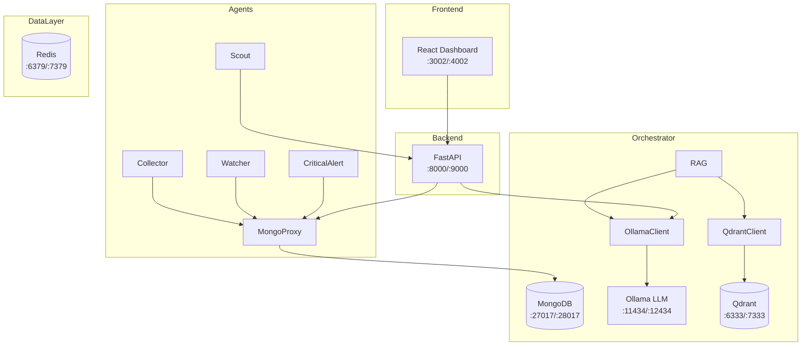

# 📁 NEXI AI CMDB - Project Manifest

> Mappa completa del progetto per sviluppatori (umani e AI).
> Aggiornato: 2026-01-11

---

## 🌳 Directory Tree

```
Nexi_DB_AI/
├── Agents/                 # 🤖 Background workers (6 agenti)
│   ├── Scout/              # Auto-discovery database Docker
│   ├── Collector/          # Raccolta metriche performance
│   ├── Watcher/            # Log streaming & forensics
│   ├── CriticalAlert/      # Email alerting
│   ├── CheckMK_Bridge/     # Sync metriche esterne
│   ├── AIAssistant/        # RAG-powered assistant
│   ├── DailyAudit/         # Report giornalieri
│   ├── Monitor/            # Container monitoring
│   └── main.py             # Entry point agenti
│
├── Orchestrator/           # 🧠 Core AI & Data Layer
│   ├── src/                # MongoProxy (interfaccia MongoDB)
│   ├── llm/                # Ollama client
│   ├── vector_db/          # Qdrant client
│   ├── rag/                # RAG pipeline
│   ├── config/             # LLM configuration
│   └── modules/            # Moduli condivisi
│
├── WebInterface/           # 🌐 Full-Stack Dashboard
│   ├── backend/            # FastAPI REST API (port 8000/9000)
│   ├── frontend-react/     # React + Vite (port 3002/4002)
│   └── frontend/           # [Legacy] Plain HTML frontend
│
├── MongoDB/                # 📊 Schema & Scripts
│   ├── Schemas/            # JSON Schema definitions
│   ├── scripts/            # Seed & migration scripts
│   ├── src/                # Connection & utility modules
│   └── struttura_mongo/    # Collection structure docs
│
├── docker-lab/             # 🐳 Docker Compose Environment
│   ├── docker-compose.yml  # V1 (porte originali)
│   ├── docker-compose-v2.yml # V2 Shadow (porte +1000)
│   └── gateway-ssh/        # SSH gateway Dockerfile
│
├── scripts/                # 🛠️ PowerShell Utilities
│   ├── start-all.ps1       # Start V1 system
│   ├── setup_v2.ps1        # Start V2 shadow system (Zero-Config)
│   ├── stop-all.ps1        # Stop V1 system
│   ├── pull_models.ps1     # Download Ollama models
│   └── ...                 # Other utilities
│
├── execution/              # ⚙️ Deterministic Python Tools
│   └── *.py                # Scripts for L3 architecture
│
├── directives/             # 📋 SOPs (Standard Operating Procedures)
│   ├── ai_chat.md          # AI chat workflow
│   ├── alert_processing.md # Alert handling
│   └── ...                 # Other directives
│
├── Tests/                  # 🧪 Integration Tests
│   ├── validate_system.py  # Full system validation
│   └── Integration/        # Integration test suites
│
├── config/                 # ⚙️ Global Configuration
├── Gateway/                # 🚪 Gateway Scripts
├── Clients/                # 📦 Client Modules
└── docs/                   # 📚 Documentation (empty)
```

---

## 🔌 Port Mapping

### V1 System (Original)

| Service | Port | Container |
|---------|------|-----------|
| MongoDB | 27017 | nexi-mongodb |
| Mongo Express | 8081 | nexi-mongo-express |
| Redis | 6379 | nexi-redis |
| Ollama | 11434 | nexi-ollama |
| Qdrant | 6333 | nexi-qdrant |
| Backend API | 8000 | (host) |
| React Frontend | 3002 | (host) |

### V2 System (Shadow Mode)

| Service | Port | Container |
|---------|------|-----------|
| MongoDB | 28017 | nexi-mongodb2 |
| Mongo Express | 9081 | nexi-mongo-express2 |
| Redis | 7379 | nexi-redis2 |
| Ollama | 12434 | nexi-ollama2 |
| Qdrant | 7333 | nexi-qdrant2 |
| Backend API | 9000 | (host) |
| React Frontend | 4002 | (host) |

---

## 🧩 Component Dependencies



---

## 🚀 Quick Start

### V1 (Original System)
```powershell
cd docker-lab
docker-compose up -d
cd ..
.\scripts\start-all.ps1
```

### V2 (Shadow System - Parallel)
```powershell
.\scripts\setup_v2.ps1
```

### Health Check Only
```powershell
.\scripts\setup_v2.ps1 -SkipDocker -SkipFrontend -SkipBackend
```

---

## 📁 Key Files

| File | Purpose |
|------|---------|
| `WebInterface/backend/main.py` | FastAPI entry point (~1000 lines) |
| `Orchestrator/src/mongo_proxy.py` | MongoDB interface via mongosh |
| `Agents/Scout/main.py` | Auto-discovery agent |
| `Agents/CriticalAlert/main.py` | Email alerting agent |
| `docker-lab/docker-compose.yml` | V1 Docker services |
| `docker-lab/docker-compose-v2.yml` | V2 Shadow services |
| `.env.v2` | V2 environment template |

---

## 🔐 Default Credentials

| Service | Username | Password |
|---------|----------|----------|
| MongoDB | admin | nexi2024 |
| PostgreSQL | postgres | nexi2024 |
| Oracle | sys | nexi2024 |
| SSH Gateway | admin | nexi |

---

## 🏷️ Labels & Tags

Per il rilascio:
- `v1.x.x` - Sistema originale
- `v2.x.x` - Post-migrazione (Clean Slate)

Branch strategy:
- `main` - Produzione stabile
- `develop` - Sviluppo attivo
- `feature/clean-migration-v2` - Migrazione V2
