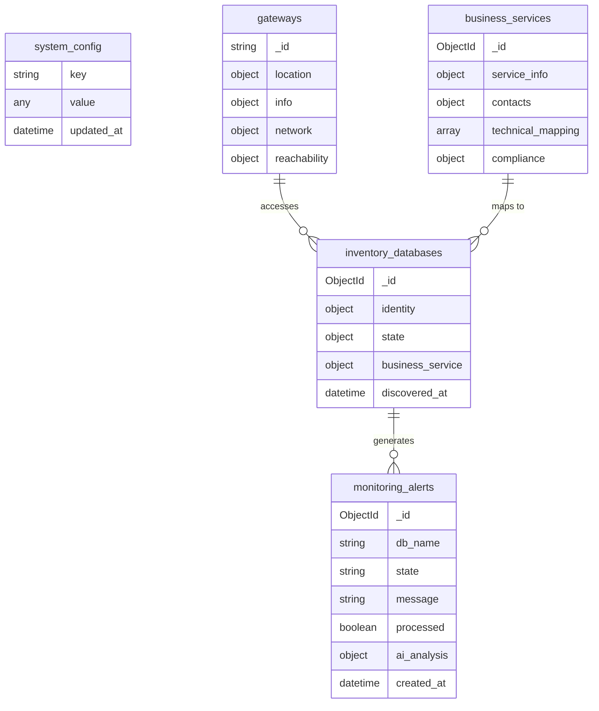

# 🗄️ MongoDB (CMDB)

> Central data store for inventory, metrics, alerts, and configuration.

---

## 🎯 AI Context

```yaml
Purpose: Configuration Management Database (CMDB)
Container: nexi-mongodb2
Port: 28017
Database: nexi_cmdb_v2
Credentials: admin / nexi2024
UI: http://localhost:9081 (Mongo Express)
```

---

## 📊 Data Model



---

## 📋 Collections Reference

| Collection | Purpose | Key Fields |
|------------|---------|------------|
| `inventory_databases` | Discovered DBs | `identity.db_unique_name`, `state.status` |
| `monitoring_alerts` | Alerts | `state`, `processed`, `ai_analysis` |
| `system_config` | Settings | `key`, `value` |
| `gateways` | SSH gateways | `_id`, `network.status` |
| `business_services` | Service mapping | `service_info.name`, `technical_mapping` |
| `agent_runs` | Execution logs | `agent_name`, `started_at` |
| `baselines` | Performance baselines | `db_name`, `metrics` |

---

## 🛠️ Commands

```powershell
# Mongo Express UI
Start-Process http://localhost:9081

# CLI access
docker exec -it nexi-mongodb2 mongosh nexi_cmdb_v2 -u admin -p nexi2024

# Seed collections (if empty)
python execution/seed_mongodb.py
```

---

## 💡 Common Queries

```javascript
// List all databases
db.inventory_databases.find({}, {
  "identity.db_unique_name": 1,
  "state.status": 1
})

// Pending alerts
db.monitoring_alerts.find({
  processed: false,
  state: "CRITICAL"
})

// Get agent intervals
db.system_config.find({key: {$regex: /interval/}})

// Update interval
db.system_config.updateOne(
  {key: "scout_interval"},
  {$set: {value: 60, updated_at: new Date()}}
)
```

---

## 📁 Schema Files

```
MongoDB/
├── struttura_mongo/
│   └── collections/
│       ├── inventory_databases/
│       ├── monitoring_alerts/
│       ├── business_services/
│       ├── gateways/
│       └── system_config/
└── scripts/
    └── seed_data.js
```

---

## 🔗 Related

- [execution/seed_mongodb.py](../execution/seed_mongodb.py) - Seed script
- [Orchestrator/src/mongo_proxy.py](../Orchestrator/src/mongo_proxy.py) - MongoDB wrapper
