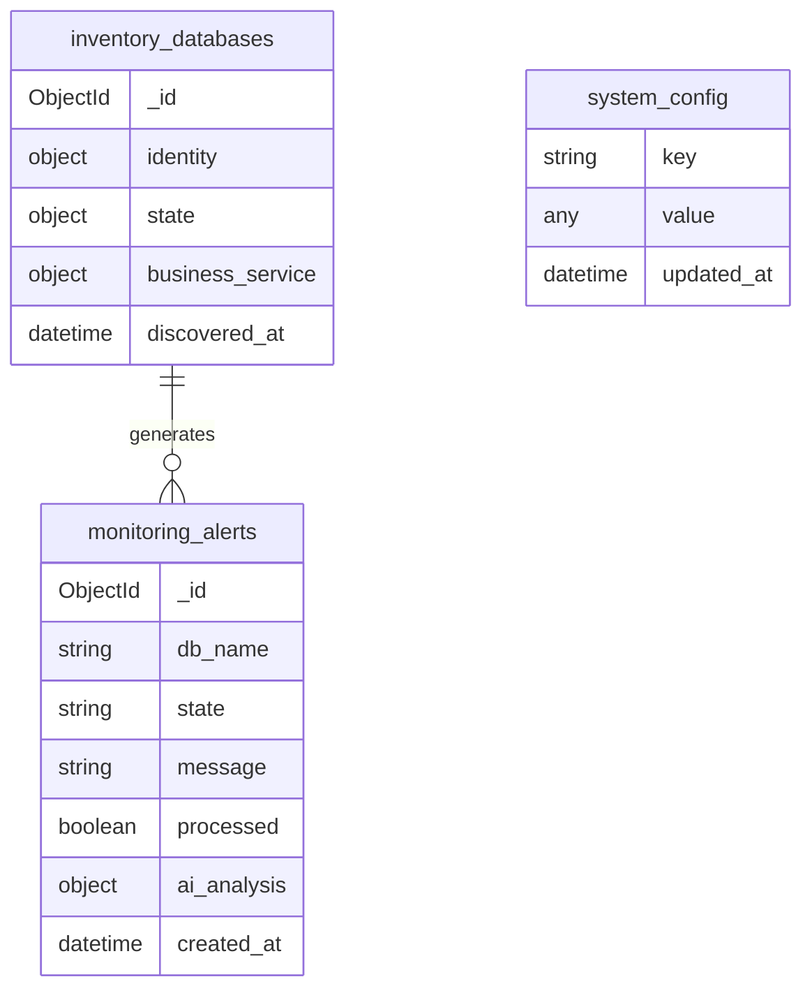

# 🗄️ MongoDB (CMDB)

> Central data store for inventory, metrics, alerts, and configuration.

This directory serves as the "Memory" of the system, defining the data models and providing tools to interact with the MongoDB instance.

---

## 📊 Data Model



---

## 📂 Directory Contents

| Directory/File | Description |
|----------------|-------------|
| **`src/`** | **Python Access Layer**. Contains `connection.py` and repository patterns for programmatic access to the DB. |
| **`scripts/`** | **Maintenance Scripts**. Python and JS scripts for fixing metadata (`fix_missing_container_names.py`), pruning inventory, etc. |
| **`struttura_mongo/`** | **Schema Definitions**. Detailed breakdown of each collection's structure and valid fields. |
| **`Schemas/`** | **JSON Schemas**. Validation schemas for data integrity. |
| **`Script_oracle_to_mongo.sql`** | **Migration Tool**. SQL script for extracting data from Oracle to import into MongoDB. |
| **`docker-compose.yml`** | Docker compose file for spinning up the MongoDB service. |

## 📋 Collections Reference

| Collection | Purpose | Key Fields |
|------------|---------|------------|
| `inventory_databases` | Discovered DBs | `identity.db_unique_name`, `state.status` |
| `monitoring_alerts` | Alerts | `state`, `processed`, `ai_analysis` |
| `system_config` | Settings | `key`, `value` |
| `gateways` | SSH gateways | `_id`, `network.status` |
| `business_services` | Service mapping | `service_info.name`, `technical_mapping` |

---

## 🛠️ Commands

```powershell
# Mongo Express UI
Start-Process http://localhost:9081

# CLI access
docker exec -it nexi-mongodb2 mongosh nexi_cmdb_v2 -u admin -p nexi2024
```

## 🔗 Related

- [execution/seed_mongodb.py](../execution/seed_mongodb.py) - Seed script
- [Orchestrator/src/mongo_proxy.py](../Orchestrator/src/mongo_proxy.py) - MongoDB wrapper
