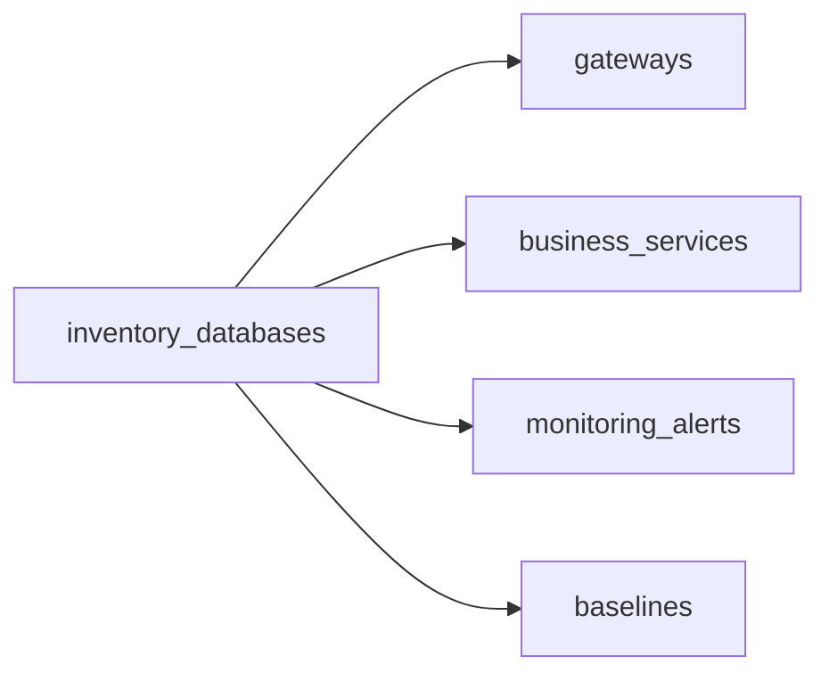

# Inventory Databases Collection

Collezione principale che rappresenta il "digital twin" di ogni database gestito.

## Scopo

- **Censimento completo** di tutti i 2000+ database Oracle, MySQL, PostgreSQL
- **Architettura hardware**: CPU, RAM, storage per ogni nodo
- **Configurazione**: versione, parametri, opzioni licenza
- **Data Protection**: backup status, replica Data Guard/Patroni
- **Metriche**: snapshot dinamici da Collector Agent
- **Gateway obbligatorio**: ogni DB deve avere identity.gateway_ref

## Relazioni



## Indici

```javascript
// Lookup per nome univoco
db.inventory_databases.createIndex(
  { "identity.db_unique_name": 1 },
  { unique: true, name: "idx_unique_dbname" }
);

// Lookup per nodo/host
db.inventory_databases.createIndex(
  { "nodes.hostname": 1, "nodes.host_ip": 1 },
  { name: "idx_nodes_lookup" }
);

// Riferimento gateway
db.inventory_databases.createIndex(
  { "identity.gateway_ref": 1 },
  { name: "idx_gateway_ref" }
);

// Dashboard monitoring
db.inventory_databases.createIndex(
  { "identity.engine": 1, "identity.environment": 1 },
  { name: "idx_monitoring_dashboard" }
);
```
