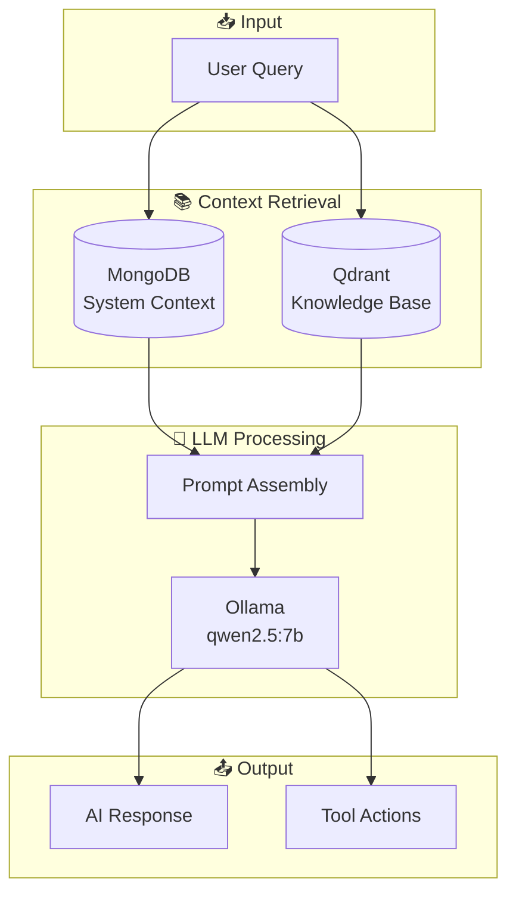

# 🧠 Orchestrator

> LLM and RAG pipeline for AI-powered chat and analysis.

This directory contains the central logic ("The Brain") of the application, managing interactions with the Large Language Model (Ollama), the Vector Database (Qdrant), and the RAG (Retrieval-Augmented Generation) pipeline.

---

## 🏗️ RAG Architecture

---

## 📂 Directory Contents

| Directory | Description |
|-----------|-------------|
| **`config/`** | Configuration files for LLM models, endpoints, and system behaviors. |
| **`llm/`** | Core LLM client abstractions and interfaces (Ollama client). |
| **`modules/`** | **AI Capabilities**. Specialized modules for different domains (e.g., `capacity`, `performance`, `tuning`) called by the LLM. |
| **`rag/`** | **RAG Pipeline**. Scripts for Embeddings generation and Document Retrieval. |
| **`src/`** | Helper scripts and utilities (e.g., `mongo_proxy.py` for resilient DB access). |
| **`vector_db/`** | Interfaces for communicating with the Qdrant vector database. |

## 📄 Key Files

| File | Description |
|------|-------------|
| **`main.py`** | **Main Entry Point**. Orchestrates the flow between user input, RAG retrieval, tool execution, and LLM response. |
| **`config/llm_config.py`** | Defines active models (e.g., `qwen2.5:7b`), context windows, and timeout settings. |

---

## 🔗 Related

- [directives/ai_chat.md](../directives/ai_chat.md) - Chat directive
- [WebInterface/backend/main.py](../WebInterface/backend/main.py) - Chat endpoint
