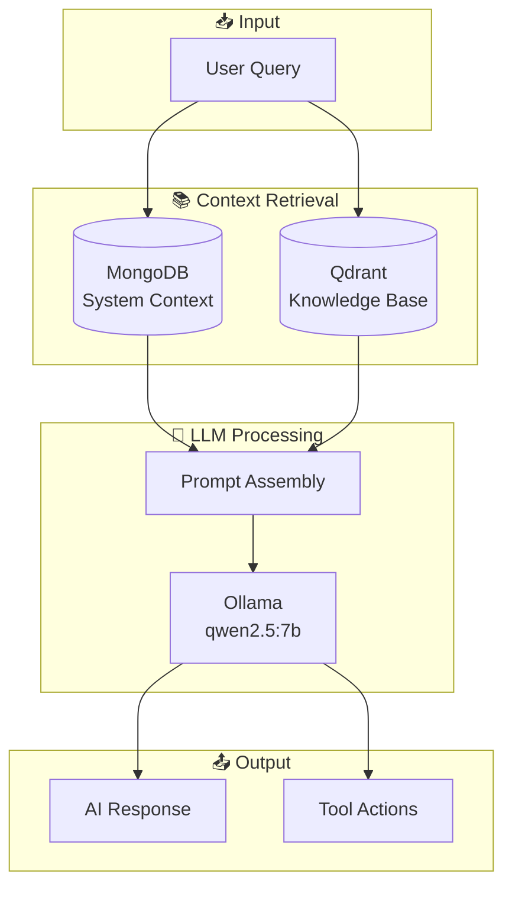

# 🧠 Orchestrator

> LLM and RAG pipeline for AI-powered chat and analysis.

---

## 🎯 AI Context

```yaml
Purpose: LLM integration and RAG pipeline
LLM: Ollama (qwen2.5:7b by default)
Vector DB: Qdrant
Key Files:
  - config/llm_config.py
  - src/mongo_proxy.py
  - rag/
```

---

## 🏗️ RAG Architecture



---

## 📋 LLM Configuration

```python
# config/llm_config.py
LLM_MODELS = {
    "qwen2.5:7b": {"context": 32768, "speed": "fast"},
    "llama3:8b": {"context": 8192, "speed": "medium"},
    "mistral:7b": {"context": 32768, "speed": "fast"},
}

OLLAMA_CONFIG = {
    "base_url": "http://localhost:12434",
    "timeout": 120,
    "options": {"num_ctx": 8192}
}
```

---

## 🔧 MongoProxy

When PyMongo fails (e.g., auth issues), use `MongoProxy` which wraps Docker CLI:

```python
from Orchestrator.src.mongo_proxy import MongoProxy

mongo = MongoProxy()
result = mongo.execute_eval("db.inventory_databases.find().toArray()")
```

---

## 📁 Structure

```
Orchestrator/
├── config/
│   └── llm_config.py      # Model settings
├── src/
│   └── mongo_proxy.py     # MongoDB via Docker
├── rag/
│   ├── embeddings.py      # Vector embeddings
│   └── retriever.py       # Document retrieval
└── prompts/
    └── system_prompts.py
```

---

## 🔗 Related

- [directives/ai_chat.md](../directives/ai_chat.md) - Chat directive
- [WebInterface/backend/main.py](../WebInterface/backend/main.py) - Chat endpoint
