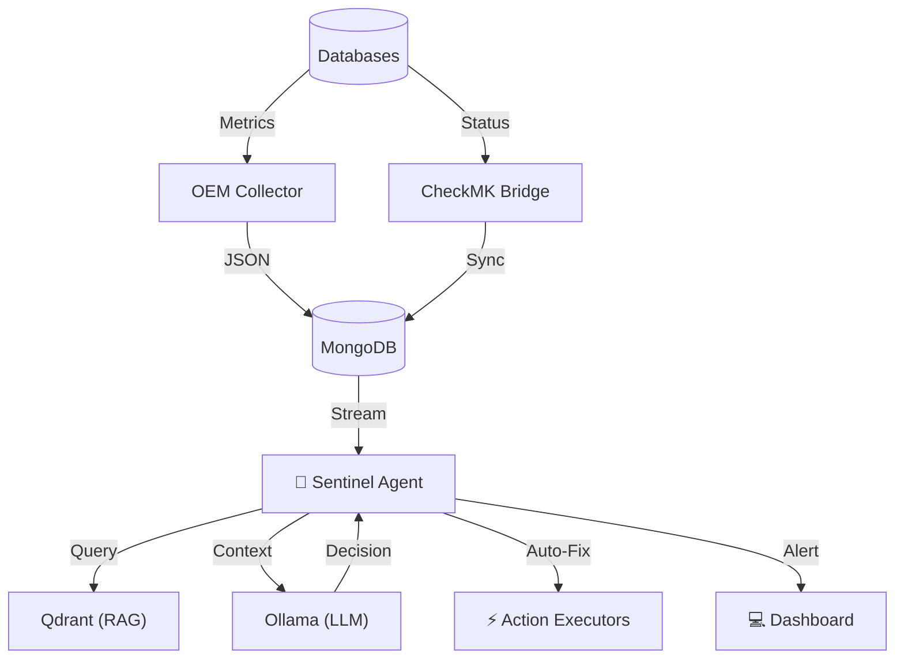

# 🌌 Nexi DBA AI: The Autonomous Database Administrator

> **Version**: 3.0 (RALPH Validated)
> **Status**: ✅ Fully Operational / Deployment Verified
> **Philosophy**: "From Chaos to Order"

---

## 📖 System Overview

Nexi DBA AI is not just a monitoring tool; it is an **Agentic AI System** designed to autonomously manage, secure, and optimize huge database fleets. It moves beyond passive alerting to active remediation using a **3-Layer Architecture**.

### 🏗️ The 3-Layer Architecture
1.  **Directives (The Law)**: Static rules and Standard Operating Procedures (SOPs) defined by humans.
2.  **Orchestration (The Brain)**: AI Agents that decide *when* to act, utilizing LLMs and RAG.
3.  **Execution (The Hands)**: Deterministic Python scripts and strict APIs that touch the infrastructure.

---

## 🧠 The Intelligence Core (RAG & LLM)

The "Brain" of the system relies on two key technologies working in tandem:

### 1. Vector Memory (RAG)
- **Technology**: Qdrant
- **Role**: Long-term memory. It stores "embeddings" of:
    - **SOPs**: How to fix specific errors.
    - **Past Incidents**: What worked before.
    - **System State**: Snapshots of configuration.
- **Workflow**: When an alert arrives, the system queries Qdrant: *"Have we seen this error before? What is the procedure?"*

### 2. The Reasoner (LLM)
- **Technology**: Ollama (Running local models like Llama3 or Mistral)
- **Role**: Decision making. It takes the context from Qdrant and the alert data to decide:
    - *"Is this a false positive?"*
    - *"Should I trigger an auto-fix?"*
    - *"Who should I notify?"*

---

## 💾 The Central Nervous System (MongoDB)

**Unification is key.** We have abolished scattered config files.

- **Centralized Configuration**: All agent configurations (intervals, thresholds, targets) live in the `system_config` collection.
- **Code-as-Data**: Operational scripts (`ops/scripts/*.py`) are stored in `system_scripts`, versioned, and executed directly from the database sans file-system dependency.
- **Inventory Source**: The `inventory_databases` collection is the Single Source of Truth, synced bi-directionally with CheckMK and OEM.

---

## 🌉 Connectivity & Data Flow

How do the components talk to each other?



### Key Flows
1.  **Enrichment**: The `EnricherAgent` continuously updates MongoDB with live metadata (Version, Uptime, Size) from Postgres/Oracle.
2.  **Sentinel Loop**:
    - **Monitor**: Scans `monitoring_alerts` and VictoriaMetrics.
    - **Predict**: Uses historical trends to foresee outages.
    - **Fix**: If `auto_fixable=True`, triggers a remediation script.
3.  **User Interaction**: Users query the system via the Dashboard. The backend uses RAG to fetch answers from the Knowledge Base + Live Data.

---

## 📈 High-Density Management (Scalability)

The system is designed to handle **4000+ databases** without lag or confusion.

- **Fast Search**: Global search by Name, Host, or IP with backend MongoDB indexing (sub-second prefix lookups).
- **Alphabetical Index (A-Z)**: Quickly filter resources by their first letter. Toggle between **"Name"** and **"Host"** index modes.
- **Hierarchical Grouping**: Optional "Group by Gateway" view with online/offline counters for aggregated control.
- **Batched Loading**: Pagination (1000 items/page) ensures the UI remains responsive even with massive inventories.

---

## 🛠️ Operational Guide

The system is containerized and managed via Docker Compose.

### 🚀 Starting the System
All services (Frontend, Backend, Agents, DBs) are defined in `ops/docker-lab/docker-compose.yml`.

```powershell
# Start everything (Windows)
.\ops\scripts\start-everything.ps1

# Verify status
python ops/scripts/mongo_runner.py verify_system.py
```

### 📜 Running Scripts (The New Way)
Do not run `.py` files manually. Use the MongoDB Runner:

```bash
# Run a specific verification script
python ops/scripts/mongo_runner.py verify_deep_state.py
```

---

## 📂 Directory Structure

| Path | Component | Function |
|:---|:---|:---|
| `api_agents/` | **Backend** | FastApi Gateway, Agents (Sentinel, Oem, Enricher). |
| `web/dashboard/` | **Frontend** | React/Vite Admin UI. |
| `orchestrator/` | **AI Logic** | RAG Pipeline, LangGraph workflow. |
| `ops/scripts/` | **Boot** | Startup/Cleanup scripts & Migration tools. |
| `mongo/` | **Schemas** | Database initialization and migrations. |

---

> **Nexi DBA AI**: Autonomous. Secure. Centralized.
