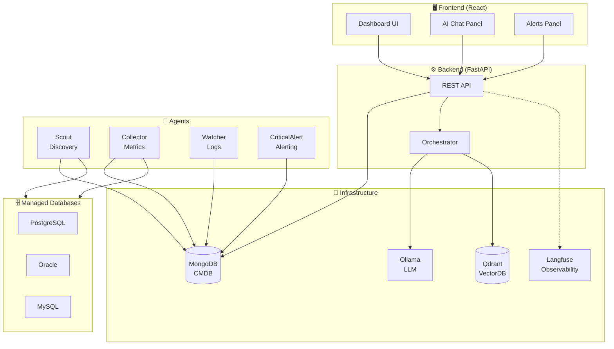
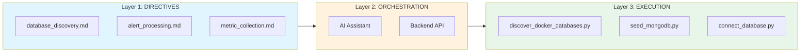
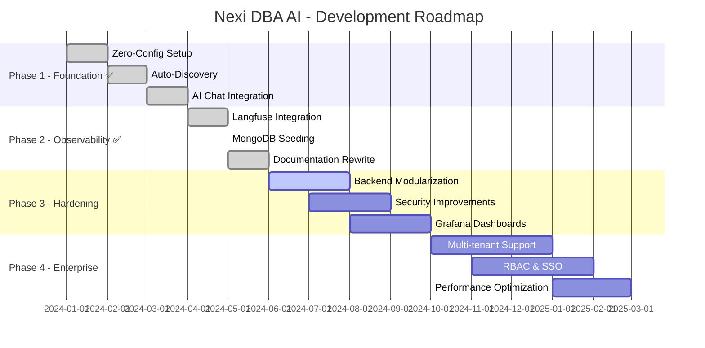
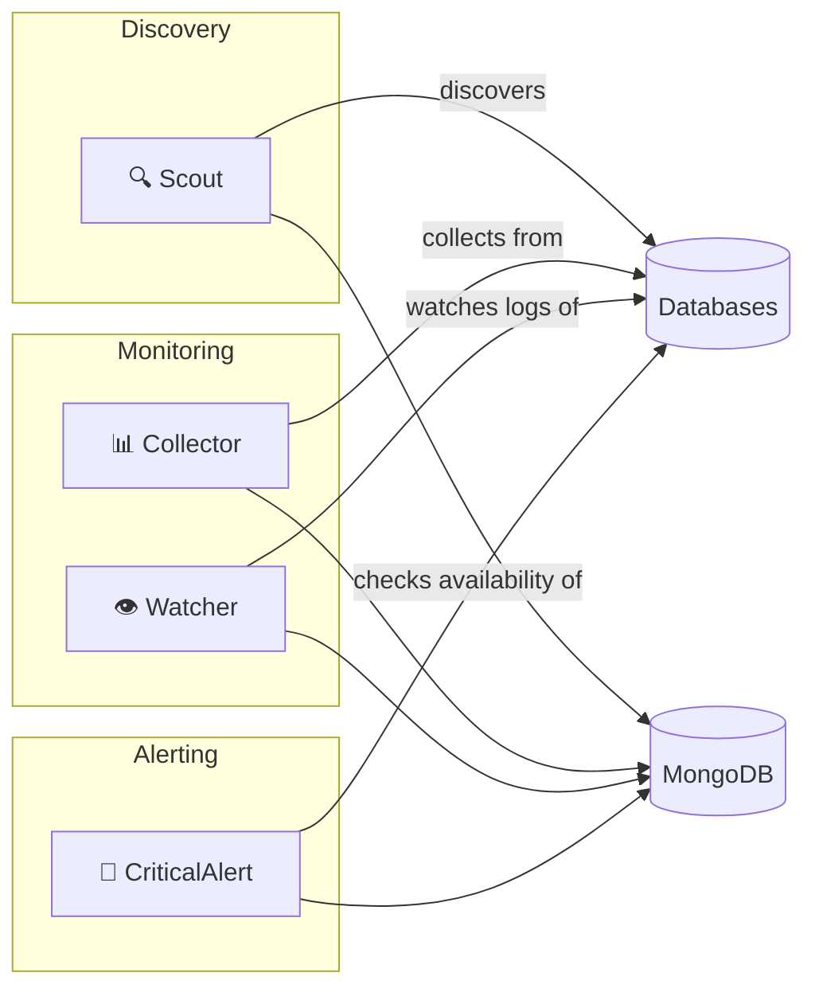

# 🤖 Nexi DBA AI

> AI-Powered Database Management Platform | CMDB + Monitoring + LLM Chat

[](https://github.com/Mohamed-DN/DB-AI)
[]()
[]()

---

## 🎯 Overview

**Nexi DBA AI** is an intelligent database operations platform that:
- 🔍 **Auto-discovers** databases in Docker environments
- 📊 **Monitors** health, metrics, and logs in real-time
- 🚨 **Alerts** when issues arise with AI-powered analysis
- 💬 **Provides AI chat** for natural language database queries

---

## 🏗️ Architecture



---

## 📂 Project Structure

```
Nexi_DB_AI/
├── 📁 Agents/                 # Background workers
│   ├── Scout/                 # Database discovery
│   ├── Collector/             # Metrics collection
│   ├── Watcher/               # Log monitoring
│   └── CriticalAlert/         # Alerting
│
├── 📁 WebInterface/
│   ├── backend/               # FastAPI API
│   └── frontend-react/        # React Dashboard
│
├── 📁 Orchestrator/           # LLM + RAG pipeline
├── 📁 execution/              # Deterministic scripts
├── 📁 directives/             # AI SOPs
├── 📁 docker-lab/             # Docker infrastructure
│
├── 📄 ARCHITECTURE.md         # Technical details
├── 📄 AGENTS.md               # Agent documentation
├── 📄 MANIFEST.md             # Port mappings
└── 📄 ROADMAP_V3.md           # Development roadmap
```

---

## 🚀 Quick Start

### Prerequisites
- Docker Desktop
- Python 3.11+
- Node.js 18+

### One-Command Setup
```powershell
# Clone the repository
git clone https://github.com/Mohamed-DN/DB-AI.git
cd DB-AI

# Copy environment template
cp .env.example .env.v2

# Start everything (zero-config)
.\scripts\setup_v2.ps1
```

### Access Points
| Service | URL |
|---------|-----|
| 🖥️ Dashboard | http://localhost:4002 |
| 📡 API Docs | http://localhost:9000/docs |
| 🗄️ MongoDB UI | http://localhost:9081 |
| 📊 Langfuse | http://localhost:3001 |

---

## 🔄 3-Layer Architecture



| Layer | Purpose | Location |
|-------|---------|----------|
| **Directives** | What to do (SOPs) | `directives/*.md` |
| **Orchestration** | Decision making | `WebInterface/backend/` |
| **Execution** | How to do it | `execution/*.py`, `Agents/` |

---

## 🗺️ Roadmap



### Current Status

| Category | Status | Details |
|----------|--------|---------|
| 🟢 **Core** | Complete | Discovery, Monitoring, Alerting |
| 🟢 **AI Chat** | Complete | Multi-DB expert with actions |
| 🟢 **Observability** | Complete | Langfuse LLM tracing |
| 🟡 **Security** | In Progress | Auth, input validation |
| ⚪ **Enterprise** | Planned | Multi-tenant, RBAC |

---

## 🤖 Agents



| Agent | Purpose | Trigger |
|-------|---------|---------|
| **Scout** | Auto-discovery | `POST /api/auto-discovery` |
| **Collector** | Metrics | `POST /api/action/collect` |
| **Watcher** | Log monitoring | Background |
| **CriticalAlert** | Availability | `POST /api/action/check` |

---

## 🔧 Configuration

### Port Mappings (V2)

| Service | Port |
|---------|------|
| Backend API | 9000 |
| Frontend UI | 4002 |
| MongoDB | 28017 |
| Mongo Express | 9081 |
| Ollama LLM | 12434 |
| Langfuse | 3001 |

### Environment Variables

See [.env.example](.env.example) for full list.

Key variables:
```bash
MONGODB_PORT=28017
BACKEND_PORT=9000
OLLAMA_PORT=12434
LANGFUSE_PUBLIC_KEY=pk-lf-...
```

---

## 📚 Documentation

| Document | Description |
|----------|-------------|
| [ARCHITECTURE.md](ARCHITECTURE.md) | Technical architecture |
| [AGENTS.md](AGENTS.md) | Agent documentation |
| [MANIFEST.md](MANIFEST.md) | Port mappings |
| [ROADMAP_V3.md](ROADMAP_V3.md) | Development roadmap |
| [FOR_AI/PROJECT_CONTEXT.md](FOR_AI/PROJECT_CONTEXT.md) | AI assistant context |

---

## 🛠️ Commands

```powershell
# Start everything
.\scripts\setup_v2.ps1

# Stop and clean
.\scripts\cleanup_v2.ps1

# Run discovery manually
python Agents/Scout/main.py --once

# Seed MongoDB
python execution/seed_mongodb.py
```

---

## 📄 License

Internal use only - Nexi Group

---

<p align="center">
  Made with ❤️ by the DBA AI Team
</p>
