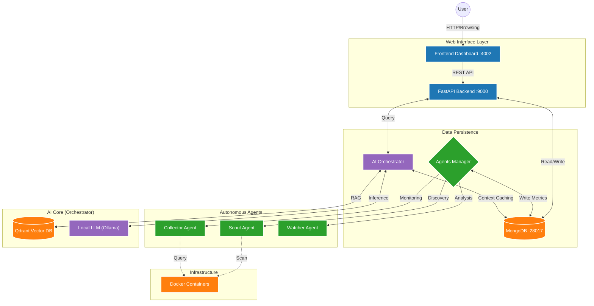

# Nexi DBA AI (CMDB V3)

> **Status**: Active Development (Shadow Mode on V2)
> **Goal**: AI-powered Autonomous Database Administration & CMDB

## 🧠 System Architecture

## 🗺️ Navigation & Directory Structure

Click on the module name to view detailed documentation and diagrams.

| Module | Icon | Role | Description |
|--------|:----:|------|-------------|
| **[api_agents](./api_agents/README.md)** | 🤖 | **Backend & Agents** | Unified backend layer with FastAPI Gateway and Autonomous Workers (`Scout`, `Collector`, `Watcher`). |
| **[orchestrator](./orchestrator/README.md)** | 🧠 | **The Brain** | The AI Core handling LLM interactions, RAG pipelines, and decision-making logic. |
| **[web](./web/README.md)** | 💻 | **The Face** | The user-facing dashboard (`web/dashboard`) and legacy interfaces. |
| **[mongo](./mongo/README.md)** | 💾 | **The Memory** | Central data store schemas, scripts, and seeds. |
| **[ops](./ops/README.md)** | 🛠️ | **Operations** | Infrastructure tools, Docker Lab (`ops/docker-lab`), and Scripts (`ops/scripts`). |
| **[llm](./llm/README.md)** | 🗣️ | **Intelligence** | Configuration and clients for Large Language Models. |

---

## 🎮 System Control

### 1. Requirements
- **Docker Desktop** (running)
- **Python 3.10+**
- **PowerShell** (Admin recommended)

### 2. Commands (Ops)
All scripts are located in `ops/scripts/`.

| Action | Command | Description |
|--------|---------|-------------|
| **🚀 START** | `.\ops\scripts\setup_v2.ps1` | Starts the full stack (Containers, API, Frontend). |
| **🛑 STOP** | `.\ops\scripts\cleanup_v2.ps1` | Stops all containers and kills python processes. |
| **🧹 CLEAN** | `docker system prune -f` | **Warning**: Removes all stopped containers (Use with caution). |

---

## 📚 Essential Reading

- **[System Architecture](docs/architecture/system_architecture.md)**: High-level design and component interaction.
- **[Agents Overview](docs/architecture/agents_overview.md)**: Details on the autonomous workers.
- **[Qdrant Basics](docs/references/qdrant_basics.md)**: Understanding the Vector DB.
- **[Audit & Roadmap](docs/audit/ROADMAP_MIGLIORAMENTO_E_AUDIT_TECNICO.md)**: Technical audit and future improvements.
- **[Project Tasks](docs/TASKS.md)**: Current development checklist and status.

---

> _"From Chaos to Order" - Built for Nexi by the Advanced Agentic Coding Team_
