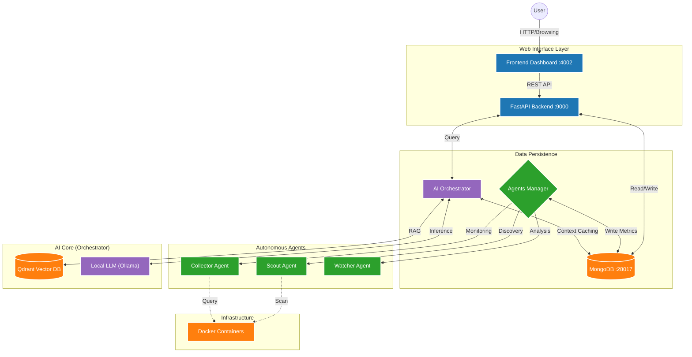

# Nexi DBA AI (CMDB V3)

> **Status**: Active Development (Shadow Mode on V2)
> **Goal**: AI-powered Autonomous Database Administration & CMDB

## 🧠 System Architecture

### The 3-Layer Operating Model

This project strictly follows a **3-Layer Architecture** to separate deterministic execution from probabilistic AI reasoning:

1. **Layer 1: Directive (Directives)**
   - Located in `matrix/directives/`.
   - 
    Standard Operating Procedures (SOPs).
   - "Rules of Engagement" for the AI (Context).

2. **Layer 2: Orchestration (The Brain)**
   - Located in `orchestrator/`.
   - Intelligent routing, decision making, and task delegation.
   - Connects intent (Directive) to action (Execution).

3. **Layer 3: Execution (The Hands)**
   - Located in `execution/`.
   - Deterministic, atomic Python scripts.
   - No AI logic here—just pure, testable code.

## 🗺️ Navigation & Directory Structure

Click on the module name to view detailed documentation and diagrams.

| Module | Icon | Role | Description |
|--------|:----:|------|-------------|
| **[api_agents](./api_agents/README.md)** | 🤖 | **Backend & Agents** | Unified backend layer with FastAPI Gateway and Autonomous Workers (`Scout`, `Collector`, `Watcher`). |
| **[orchestrator](./orchestrator/README.md)** | 🧠 | **The Brain** | The AI Core handling LLM interactions, RAG pipelines, and decision-making logic. |
| **[web](./web/README.md)** | 💻 | **The Face** | The user-facing dashboard (`web/dashboard`) and legacy interfaces. |
| **[mongo](./mongo/README.md)** | 💾 | **The Memory** | Central data store schemas, scripts, and seeds. |
| **[ops](./ops/README.md)** | 🛠️ | **Operations** | Infrastructure tools, Docker Lab (`ops/docker-lab`), and Scripts (`ops/scripts`). |
| **[llm](./llm/README.md)** | 🗣️ | **Intelligence** | Configuration and clients for Large Language Models. |

---

## 🎮 System Control

### 1. Requirements
- **Docker Desktop** (running)
- **Python 3.10+**
- **PowerShell** (Admin recommended)

### 2. Commands (Ops)
All scripts are located in `ops/scripts/`.

| Action | Command | Description |
|--------|---------|-------------|
| **🚀 START** | `.\ops\scripts\setup_v2.ps1` | Starts the full stack (Containers, API, Frontend). |
| **🛑 STOP** | `.\ops\scripts\cleanup_v2.ps1` | Stops all containers and kills python processes. |
| **🧹 CLEAN** | `docker system prune -f` | **Warning**: Removes all stopped containers (Use with caution). |

---

## � Future Architecture & Data Sources

### Data Sources
The system integrates 4 main data streams for holistic monitoring:
1. **CheckMK**: Infrastructure status and legacy alerts.
2. **OEM (Oracle Enterprise Manager)**: Deep database performance metrics.
3. **Database**: Direct SQL queries for internal state and logs.
4. **Machine**: OS-level metrics (CPU, RAM, Disk I/O).

### Infrastructure Evolution
We are moving towards a distributed gateway architecture:
- **Current State**: 2 Primary Gateways connecting Machines to MongoDB and AI Core.
- **Future State**: 3+ Gateways for high availability and load balancing.
- **Queue Management**: **Redis** will be deployed on ALL gateways to handle message queues, replacing direct synchronous connections for better resilience.

---

## �📚 Essential Reading

- **[System Architecture](docs/architecture/system_architecture.md)**: High-level design and component interaction.
- **[Agents Overview](docs/architecture/agents_overview.md)**: Details on the autonomous workers.
- **[Qdrant Basics](docs/references/qdrant_basics.md)**: Understanding the Vector DB.
- **[Audit & Roadmap](docs/audit/ROADMAP_MIGLIORAMENTO_E_AUDIT_TECNICO.md)**: Technical audit and future improvements.
- **[Sentinel Implementation Walkthrough](docs/SENTINEL_WALKTHROUGH.md)**: Full guide to the Intelligent DBA Sentinel System.
- **[Sentinel Task Tracker](docs/SENTINEL_TASK.md)**: Implementation status and checklist.
- **[Project Tasks](docs/TASKS.md)**: Current development checklist and status.

---

## 🛠️ Detailed Implementation Roadmap

To achieve the **Future Architecture** (3 Gateways, Redis, 4 Sources), the work is broken down into manageable phases.

### Phase 1: Infrastructure Foundations (Redis & Queueing)
- [ ] **Redis Deployment**: Add Redis service to `docker-compose` and `ops/scripts`.
- [ ] **Queue Implementation**: Create `RedisClient` in `api_agents/shared` for async messaging.
- [ ] **Agent Decoupling**: Refactor Agents (Collector, Scout) to push data to Redis instead of direct MongoDB writes.
- [ ] **Ingestion Workers**: Create dedicated workers to consume from Redis and write to MongoDB (Async Write).

### Phase 2: Distributed Gateway Architecture
- [ ] **Gateway Config**: Define configuration profiles for `Gateway_01`, `Gateway_02`, `Gateway_03`.
- [ ] **Load Balancing**: Implement logic to distribute Agents across gateways.
- [ ] **Failover Logic**: If Gateway 01 fails, agents should fallback to Gateway 02.
- [ ] **Service Discovery**: Update `Scout` to register machines against specific Gateways.

### Phase 3: Data Source Unification (The 4 Streams)
- [ ] **Stream 1: CheckMK**: Finalize `checkmk_legacy_adapter` for stable event streaming.
- [ ] **Stream 2: OEM**: Optimize `oem_collector` for high-frequency polling.
- [ ] **Stream 3: Database**: Standardize `PredictorAgent` queries for direct DB health.
- [ ] **Stream 4: Machine**: Integrate `psutil` or `Telegraf` into `Watcher` agent for OS metrics (CPU/RAM/IO).

### Phase 4: Frontend & Visualization
- [ ] **Gateway Dashboard**: New UI view to monitor the status of the 3 Gateways + Redis Queues.
- [ ] **Unified Timeline**: Merge events from CheckMK, OEM, and Sentinel into a single timeline.
- [ ] **Real-time Updates**: Connect Frontend to Redis Pub/Sub for live status changes.

### Phase 5: Hardening & Production
- [ ] **Security**: Implement API Keys for Gateway-to-Gateway communication.
- [ ] **Disaster Recovery**: Simulate Gateway failure and verify Agent migration.
- [ ] **Performance Tuning**: Optimize Redis retention and MongoDB write throughput.

---

> _"From Chaos to Order" - Built for Nexi by the Advanced Agentic Coding Team_
