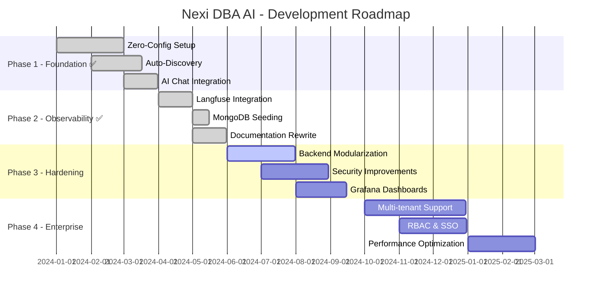
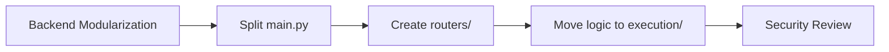

# 🗺️ ROADMAP V3

> Development roadmap for Nexi DBA AI.

---

## 🎯 AI Context

```yaml
Current Phase: Phase 2 Complete, Phase 3 In Progress
Branch: v3 (development) → v2 (production)
Next Priority: Backend modularization, security
```

---

## 📅 Timeline



---

## ✅ Completed

### Phase 1: Foundation
- [x] Docker-based infrastructure (V2 shadow mode)
- [x] Zero-config setup with `setup_v2.ps1`
- [x] Scout agent for auto-discovery
- [x] AI chat with multi-DB expertise
- [x] React dashboard

### Phase 2: Observability
- [x] Langfuse LLM tracing
- [x] Headless Langfuse initialization
- [x] MongoDB seeding script
- [x] 3-Layer Architecture documentation
- [x] All README files with mermaid diagrams

---

## 🚧 In Progress

### Phase 3: Hardening (Current)

| Task | Status | Priority |
|------|--------|----------|
| Backend modularization | 🟡 In Progress | HIGH |
| Remove hardcoded credentials | ⚪ Planned | HIGH |
| Input validation | ⚪ Planned | HIGH |
| Error handling | ⚪ Planned | MEDIUM |
| Grafana dashboards | ⚪ Planned | MEDIUM |

---

## 📋 Backlog

### Phase 4: Enterprise

| Task | Priority |
|------|----------|
| Multi-tenant support | HIGH |
| Role-Based Access Control (RBAC) | HIGH |
| SSO integration | MEDIUM |
| Performance optimization | MEDIUM |
| High availability | LOW |

---

## 🎯 Next Actions



1. **Split `main.py`** into modular routers
2. **Create execution scripts** for agent spawning
3. **Add authentication** to API
4. **Grafana dashboards** for metrics

---

## 🔗 Related

- [ARCHITECTURE.md](ARCHITECTURE.md) - Current architecture
- [AGENTS.md](AGENTS.md) - Agent documentation
