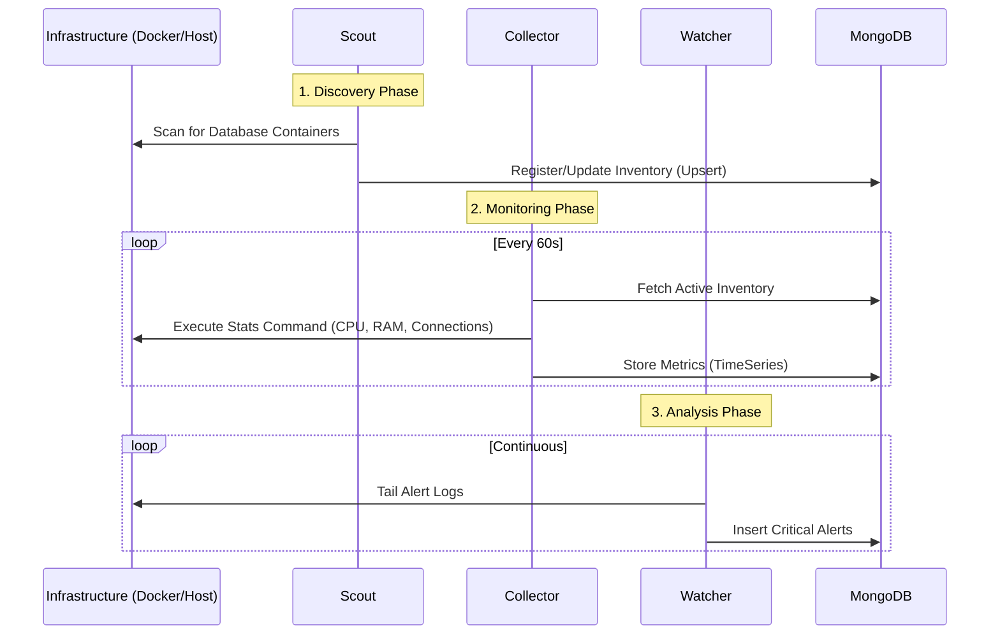

# 🤖 Agents Layer

> **Role**: The "Hands" of the system.
> **Responsibility**: Discovery, Monitoring, Auditing, and Alerting.

## 🔄 Interaction Flow

How the agents coordinate to keep the system up-to-date:

## 📂 Agent Directory

| Agent | Directory | Key Function | Command |
|-------|-----------|--------------|---------|
| **Scout** | [`Scout/`](./Scout) | **Discovery**: Finds new database containers and registers them in the inventory. | `python Agents/Scout/main.py --once` |
| **Collector** | [`Collector/`](./Collector) | **Metrics**: Polls databases for performance stats (CPU, Memory, Sessions). | `python Agents/Collector/main.py` |
| **Watcher** | [`Watcher/`](./Watcher) | **Logs**: Real-time log monitoring for errors (ORA-*, FATAL, etc.). | `python Agents/Watcher/main.py` |
| **CriticalAlert** | [`CriticalAlert/`](./CriticalAlert) | **Notifications**: Sends emails/webhooks when critical thresholds are breached. | `python Agents/CriticalAlert/main.py` |
| **DailyAudit** | [`DailyAudit/`](./DailyAudit) | **Compliance**: Runs daily checks for configuration drift and security. | `python Agents/DailyAudit/main.py` |

---

### 🛠️ Developer Notes

- Agents are designed to be **stateless**; they read configuration from MongoDB and write results back to MongoDB.
- All agents respect the global configuration in `config/` (or environment variables).
- **V2/V3 Compatibility**: Use `GATEWAY_SUFFIX` in `.env.v2` to distinguish between environments.
