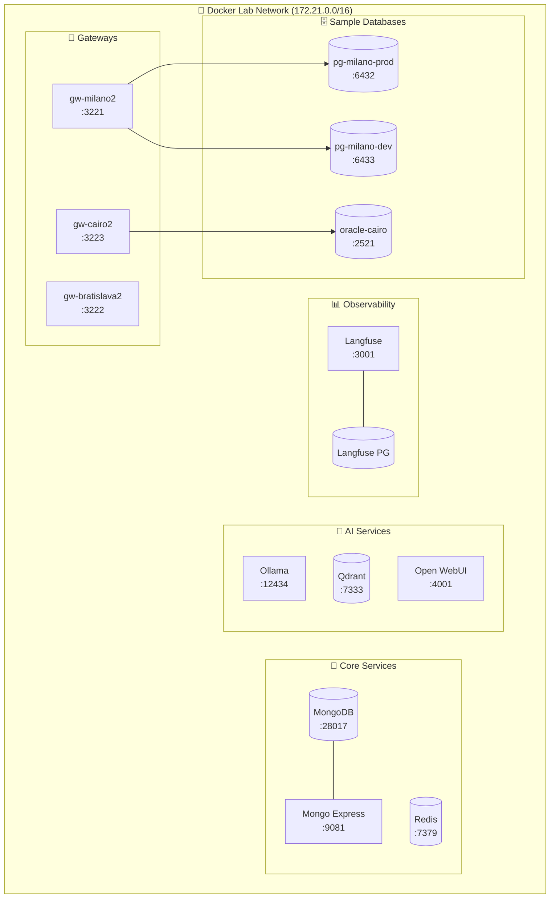

# 🐳 Docker Lab

> Local infrastructure for development and testing.

---

## 🎯 AI Context

```yaml
Purpose: Containerized infrastructure for V2 shadow mode
Compose File: docker-compose-v2.yml
Network: docker-lab_nexi-lab2 (172.21.0.0/16)
Start: .\scripts\setup_v2.ps1
Stop: .\scripts\cleanup_v2.ps1
```

---

## 🏗️ Infrastructure Overview



---

## 📋 Service Reference

### Core Services

| Service | Container | Port | IP |
|---------|-----------|------|-----|
| MongoDB | nexi-mongodb2 | 28017 | 172.21.0.10 |
| Mongo Express | nexi-mongo-express2 | 9081 | - |
| Redis | nexi-redis2 | 7379 | - |

### AI Services

| Service | Container | Port | IP |
|---------|-----------|------|-----|
| Ollama | nexi-ollama2 | 12434 | 172.21.0.11 |
| Qdrant | nexi-qdrant2 | 7333 | 172.21.0.12 |
| Open WebUI | nexi-open-webui2 | 4001 | - |

### Observability

| Service | Container | Port | IP |
|---------|-----------|------|-----|
| Langfuse | nexi-langfuse2 | 3001 | 172.21.0.21 |
| Langfuse DB | nexi-langfuse-db2 | - | 172.21.0.20 |

### Gateways

| Gateway | Container | Port | Location |
|---------|-----------|------|----------|
| Milano | nexi-gw-milano2 | 3221 | Italy |
| Bratislava | nexi-gw-bratislava2 | 3222 | Slovakia |
| Cairo | nexi-gw-cairo2 | 3223 | Egypt |

---

## 🛠️ Commands

```powershell
# Start all V2 infrastructure
cd docker-lab
docker-compose -f docker-compose-v2.yml up -d

# Or use setup script (recommended)
.\scripts\setup_v2.ps1

# Stop and remove everything
.\scripts\cleanup_v2.ps1

# View running containers
docker ps --filter "name=nexi" --format "table {{.Names}}\t{{.Status}}\t{{.Ports}}"
```

---

## 📁 Files

```
docker-lab/
├── docker-compose-v2.yml    # V2 shadow mode
├── docker-compose.yml       # V1 (legacy)
└── init/                    # Init scripts
```

---

## 🔗 Related

- [MANIFEST.md](../MANIFEST.md) - Full port reference
- [scripts/setup_v2.ps1](../scripts/setup_v2.ps1) - Startup script
