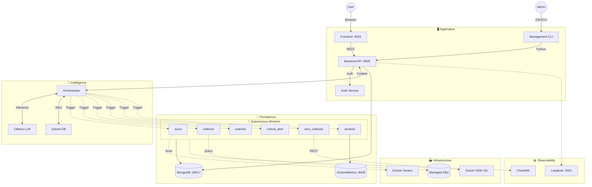

# 🏗️ System Architecture

> **The Single Source of Truth** for M-DN DBA AI Architecture.

---

## 🎯 High-Level Overview

M-DN DBA AI is an **Autonomous Database Administration System** built on a **3-Layer Architecture**:
1.  **Directive Layer**: Standard Operating Procedures (SOPs) that define *WHAT* to do.
2.  **Orchestration Layer**: The AI Brain that decides *WHEN* and *WHICH* tools to use.
3.  **Execution Layer**: Deterministic Agents and Scripts that perform the *HOW*.

### 🧩 Core Components

| Component | Port | Description |
|-----------|------|-------------|
| **Frontend** | 4002 | React/Vite Dashboard |
| **Backend** | 8000 | FastAPI Gateway & Orchestrator |
| **MongoDB** | 28017 | Primary Data Store (CMDB) |
| **Qdrant** | 7333 | Vector Knowledge Base (RAG) |
| **Ollama** | 11434 | Local LLM Inference |

---

## 📐 Architecture Diagram

---

## 🔄 Data Flow

### 1. Auto-Discovery Flow
1.  **Trigger**: User clicks "Scan" or Schedule fires.
2.  **Orchestrator**: dispatches `scout` agent.
3.  **Execution**: `scout` scans Docker/Network for DB services.
4.  **Storage**: Upserts findings to `inventory_databases` in MongoDB.
5.  **Notification**: Updates Frontend via WebSocket/Polling.

### 2. Predictive Alerting Flow (Sentinel)
1.  **Ingestion**: `oem_collector` & `collector` push metrics to VictoriaMetrics.
2.  **Analysis**: `sentinel` agent queries VictoriaMetrics for patterns (e.g., memory leak).
3.  **Verification**: AI Verifier cross-references with RAG Knowledge Base.
4.  **Action**: If critical, triggers `critical_alert` to email Admin.

### 3. AI Copilot Flow
1.  **Input**: User asks "Why is Oracle slow?" in Dashboard.
2.  **RAG**: Orchestrator retrieves relevant context (metrics, logs, SOPs) from Qdrant.
3.  **Reasoning**: LLM generates diagnosis based on context.
4.  **Response**: Returns actionable advice or offers to run a diagnostic script.

---

## 📂 Directory Map

| Path | Purpose | Key Files |
|------|---------|-----------|
| `api_agents/` | Backend & Agents | `main.py`, `workers/` |
| `web/dashboard/` | Frontend | `vite.config.ts`, `src/` |
| `orchestrator/` | AI Logic | `rag/`, `llm/` |
| `docs/directives/` | SOPs (Layer 1) | `*.md` |
| `ops/` | DevOps & Scripts | `docker-compose.yml` |
| `mongo/` | Data Schemas | `schemas/` |

---

## 🔗 Reference

- **[Directives](../directives/)**: Detailed SOPs for each agent.
- **[Manifest](repo_manifest.md)**: Port mappings and services.
- **[Task Tracker](../TASKS.md)**: Current progress.
