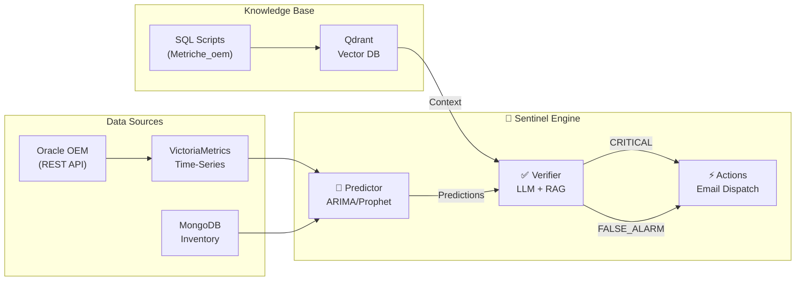

# Intelligent DBA Sentinel System - Implementation Walkthrough

## Summary

Successfully implemented the **Intelligent DBA Sentinel System** - a Multi-Agent System (MAS) for autonomous database monitoring, prediction, and remediation.

## Architecture Overview



---

## Files Created

### Core Sentinel Engine
| File | Purpose |
|------|---------|
| [oem_collector.py](file:///c:/AI-Nexi/Nexi_DB_AI/api_agents/workers/OEM_Collector/oem_collector.py) | **NEW:** Oracle OEM metrics collector |
| [sentinel_rag_ingester.py](file:///c:/AI-Nexi/Nexi_DB_AI/api_agents/workers/Sentinel/sentinel_rag_ingester.py) | **NEW:** SQL/Doc ingestion for RAG |
| [sentinel_workflow.py](file:///c:/AI-Nexi/Nexi_DB_AI/api_agents/workers/Sentinel/sentinel_workflow.py) | Main orchestration workflow |
| [predictor_agent.py](file:///c:/AI-Nexi/Nexi_DB_AI/api_agents/workers/Sentinel/predictor_agent.py) | Forecasting agent (ARIMA/Prophet) |
| [verifier_agent.py](file:///c:/AI-Nexi/Nexi_DB_AI/api_agents/workers/Sentinel/verifier_agent.py) | LLM verification agent |

### Ops & Monitoring
| File | Purpose |
|------|---------|
| [sentinel_overview.json](file:///c:/AI-Nexi/Nexi_DB_AI/ops/monitoring/grafana/dashboards/sentinel_overview.json) | **NEW:** Grafana dashboard model |

---

## How to Run

### 1. Start Support Services
Ensure **Qdrant** (port 7333) and **VictoriaMetrics** (port 8428) are running.

### 2. Run Data Collection
```powershell
# Collect metrics from Oracle OEM
curl -X POST http://localhost:8000/api/action/oem-collect
```

### 3. Build Knowledge Base
```powershell
# Index SQL scripts from Metriche_oem
curl -X POST http://localhost:8000/api/action/rag-ingest
```

### 4. Run Sentinel Analysis
```powershell
# Trigger predictive analysis cycle
curl -X POST http://localhost:8000/api/action/sentinel
```

### 5. Check Status
```powershell
# View system status
curl http://localhost:8000/api/sentinel/status
```

---

## Configuration

### OEM Instances
Configure in MongoDB `system_config` or environment variable:
```bash
OEM_INSTANCES="Production|https://oem.prod.corp:7803/em|sysman|password"
```

### Grafana Dashboard
Import `ops/monitoring/grafana/dashboards/sentinel_overview.json` into Grafana to visualize:
- High probability anomalies
- Time to predicted events
- Forecast trends
