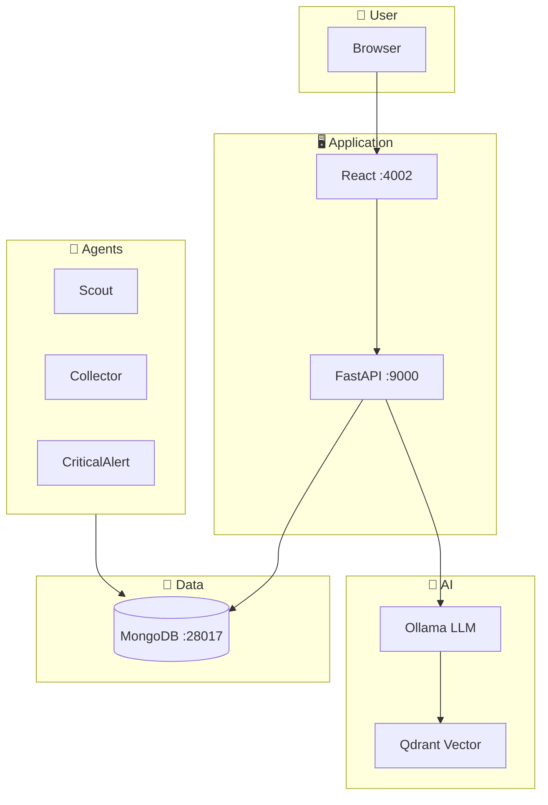
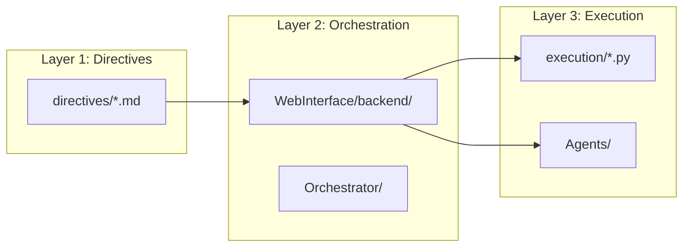
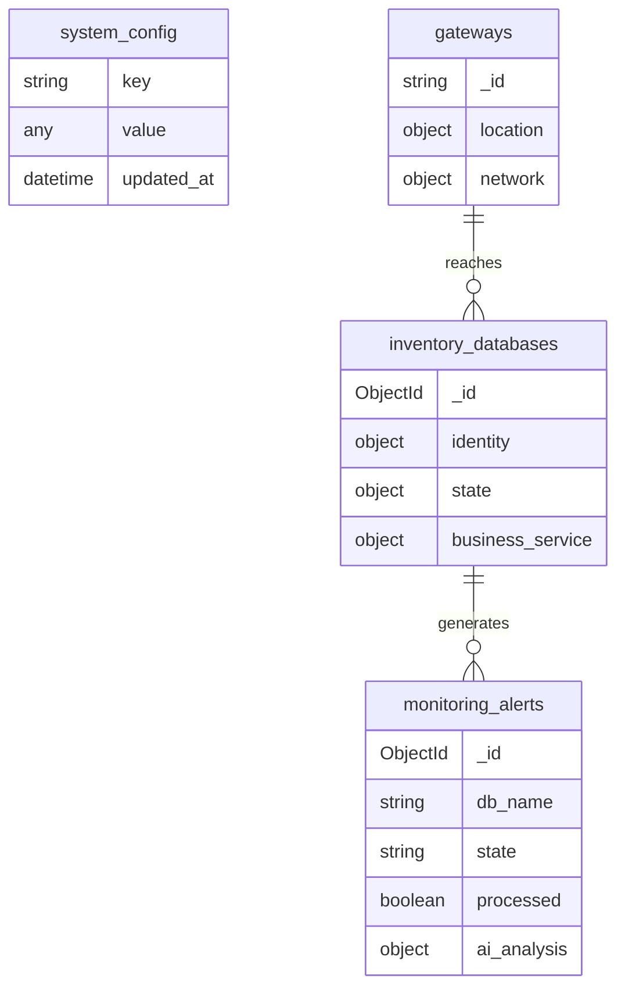

# 🧠 AI Project Context

> Master reference for AI assistants. **Read this first.**

---

## 🎯 Quick Context

```yaml
Project: M-DN DBA AI
Purpose: AI-powered database monitoring and management CMDB
Version: V3 (Shadow Mode on V2 ports)
Stack: Python/FastAPI + React + MongoDB + Ollama LLM

# Critical Ports (ALWAYS use these)
Backend: 8000
Frontend: 4002
MongoDB: 28017
Langfuse: 3001

# Environment
Config File: .env.v2 (NOT .env)
Gateway Suffix: GATEWAY_SUFFIX=2
```

---

## 🏗️ Architecture Overview



---

## 📂 Directory Map



| Path | Layer | Purpose |
|------|-------|---------|
| `directives/` | L1 | SOPs (what to do) |
| `WebInterface/backend/` | L2 | API & routing |
| `Orchestrator/` | L2 | LLM + RAG |
| `execution/` | L3 | Deterministic scripts |
| `Agents/` | L3 | Background workers |

---

## ⚡ Key Commands

```powershell
# Start everything (zero-config)
.\scripts\setup_v2.ps1

# Stop and clean everything
.\scripts\cleanup_v2.ps1

# Run database discovery
python Agents/Scout/main.py --once

# Seed MongoDB collections
python execution/seed_mongodb.py
```

---

## 📊 MongoDB Collections



| Collection | Purpose |
|------------|---------|
| `inventory_databases` | Discovered databases |
| `monitoring_alerts` | Active alerts |
| `system_config` | Agent intervals, global settings |
| `gateways` | SSH gateway info |
| `business_services` | Service-to-DB mapping |

---

## 🔧 When You Need To...

| Task | Action |
|------|--------|
| Fix a bug | Edit code → Test with `setup_v2.ps1` → Commit to v3 |
| Add feature | Update directive first → Then implement |
| Debug "error loading" | Check backend logs, verify ports |
| Reset everything | `cleanup_v2.ps1` → `setup_v2.ps1` |
| Push to personal repo | `git push personal v3:main` |

---

## ⚠️ Critical Constraints

1. **Always V2 Ports**: Backend `8000`, MongoDB `28017`, Frontend `4002`
2. **Environment File**: Use `.env.v2` (not `.env`)
3. **Gateway Suffix**: `GATEWAY_SUFFIX=2` for V2 containers
4. **Branch Strategy**: Develop on `v3`, sync to `v2`

---

## 🔗 Related Files

| Document | Description |
|----------|-------------|
| [README.md](../README.md) | Quick start |
| [ARCHITECTURE.md](../ARCHITECTURE.md) | Technical architecture |
| [AGENTS.md](../AGENTS.md) | Agent documentation |
| [MANIFEST.md](../MANIFEST.md) | Port mappings |
| [ROADMAP_V3.md](../ROADMAP_V3.md) | Development roadmap |
