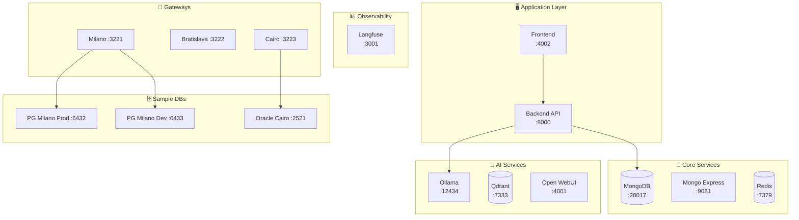

# 📋 MANIFEST

> Port mappings and service registry for M-DN DBA AI.

---

## 🎯 AI Context

```yaml
Purpose: Central port reference for V2 shadow mode
Version: V2 (all services suffixed with "2")
Network: docker-lab_m-dn-lab2 (172.21.0.0/16)
```

---

## 🏢 Service Map



---

## 📋 Port Reference

### Application

| Service | Port | Container |
|---------|------|-----------|
| **Backend API** | 8000 | (process) |
| **Frontend UI** | 4002 | (process) |

### Infrastructure

| Service | Port | Container |
|---------|------|-----------|
| MongoDB | 28017 | m-dn-mongodb2 |
| Mongo Express | 9081 | m-dn-mongo-express2 |
| Redis | 7379 | m-dn-redis2 |
| Ollama LLM | 12434 | m-dn-ollama2 |
| Qdrant | 7333 | m-dn-qdrant2 |
| Open WebUI | 4001 | m-dn-open-webui2 |
| **Langfuse** | **3001** | m-dn-langfuse2 |

### Gateways

| Gateway | Port | Container |
|---------|------|-----------|
| Milano | 3221 | m-dn-gw-milano2 |
| Bratislava | 3222 | m-dn-gw-bratislava2 |
| Cairo | 3223 | m-dn-gw-cairo2 |

### Sample Databases

| Database | Type | Port |
|----------|------|------|
| Milano PROD | PostgreSQL | 6432 |
| Milano DEV | PostgreSQL | 6433 |
| Milano STG | PostgreSQL | 6435 |
| Bratislava PROD | PostgreSQL | 6444 |
| Bratislava DEV | PostgreSQL | 6434 |
| Cairo Primary | Oracle | 2521 |
| Cairo Replica | Oracle | 2522 |

---

## 🔗 URLs

| Service | URL |
|---------|-----|
| 🖥️ Dashboard | http://localhost:4002 |
| 📡 API Docs | http://localhost:8000/docs |
| 🗄️ MongoDB UI | http://localhost:9081 |
| 📊 Langfuse | http://localhost:3001 |
| 🤖 Ollama | http://localhost:12434 |

---

## 🛠️ Commands

```powershell
# Start all
.\scripts\setup_v2.ps1

# Stop all
.\scripts\cleanup_v2.ps1

# Check running containers
docker ps --filter "name=m-dn" --format "table {{.Names}}\t{{.Ports}}"
```
