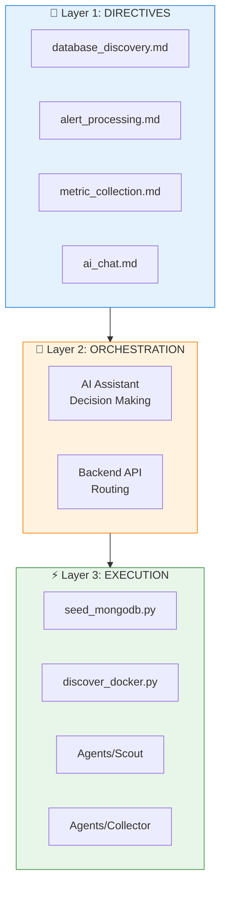
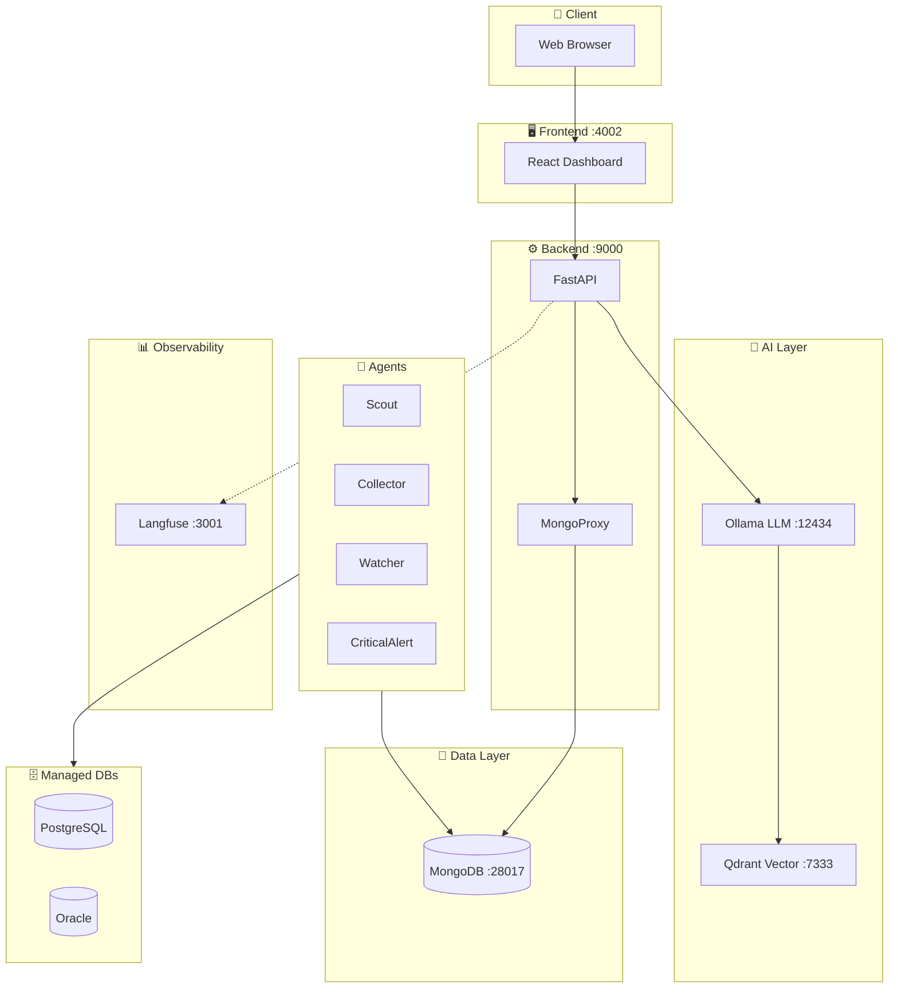
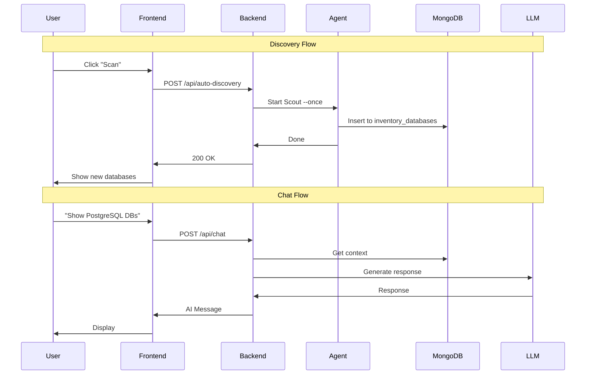
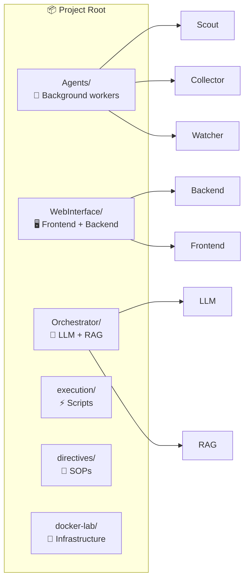
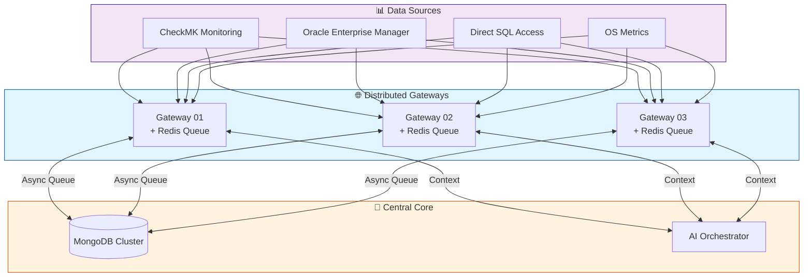

# 🏗️ Architecture

> Technical architecture of the Nexi DBA AI platform.

---

## 🎯 AI Context

```yaml
Purpose: AI-powered CMDB with auto-discovery, monitoring, and LLM chat
Pattern: 3-Layer Architecture (Directives → Orchestration → Execution)
Stack: Python/FastAPI + React + MongoDB + Ollama LLM
Ports: Backend 9000, Frontend 4002, MongoDB 28017
```

---

## 🔄 3-Layer Architecture



### Why This Works

| Layer | Responsibility | Example |
|-------|---------------|---------|
| **Directives** | WHAT to do | "Discover databases in Docker" |
| **Orchestration** | WHICH script to run | AI decides to call Scout |
| **Execution** | HOW to do it | `Scout/main.py` runs discovery |

---

## 🏢 System Architecture



---

## 📊 Data Flow



---

## 📁 Directory Structure



---

## 🔌 Integration Points

| Component | Protocol | Port | Purpose |
|-----------|----------|------|---------|
| Frontend → Backend | HTTP/REST | 9000 | API calls |
| Backend → MongoDB | MongoDB | 28017 | Data storage |
| Backend → Ollama | HTTP | 12434 | LLM inference |
| Backend → Langfuse | HTTP | 3001 | Observability |
| Agents → MongoDB | MongoDB | 28017 | Results storage |

---

## 🔗 Related

- [README.md](README.md) - Quick start
- [AGENTS.md](AGENTS.md) - Agent documentation
- [MANIFEST.md](MANIFEST.md) - Port mappings

---

## 🔮 Future Architecture Vision

The platform is evolving towards a distributed, high-availability architecture with **3 Gateways** and **Redis-based Queues**.



### Key Changes
1. **Redundancy**: Moving from 2 to **3 Gateways** to ensure zero downtime.
2. **Asynchronous Processing**: **Redis Queues** on each gateway decouple data ingestion from processing.
3. **Unified Ingestion**: All 4 data sources (CheckMK, OEM, DB, Machine) flow through the same gateway layer.

