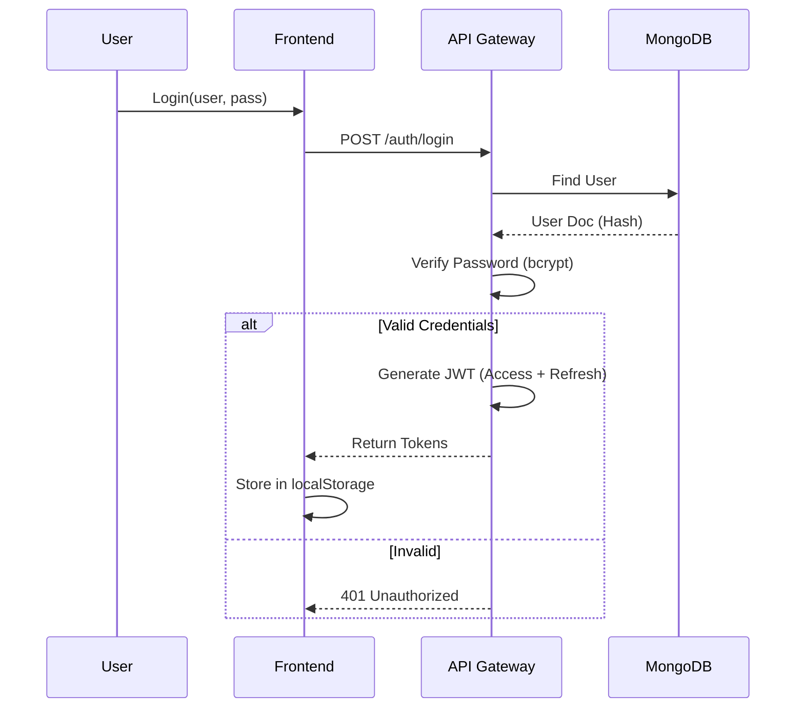

# Authentication & Authorization

> Standard Operating Procedure for User Authentication and RBAC.

## Goal
Secure all API endpoints using JWT-based authentication with Role-Based Access Control (RBAC) to ensure only authorized users can access sensitive database operations.

## Inputs
- **User Credentials**: Username and Password submitted via login form.
- **JWT Secret**: `M-DN_JWT_SECRET` environment variable (auto-generated if missing).
- **JWT Algorithm**: HS256 (default).

## Execution Scripts (Layer 3)
- `api_agents/api_gateway/services/auth_service.py`: Core logic for hashing, token generation, and validation.
- `api_agents/api_gateway/routes/auth.py`: API endpoints for login/refresh.
- `api_agents/api_gateway/middleware/auth_middleware.py`: Request interception and token verification.

## Architecture

## Outputs
- **Access Token**: Short-lived (e.g., 30m) JWT for API access.
- **Refresh Token**: Long-lived (e.g., 7d) JWT for obtaining new access tokens.
- **User Session**: Logged in `users` collection/audit log.

## Edge Cases
1. **Token Expiration**:
   - Client must use Refresh Token to get new Access Token.
   - If Refresh Token expired -> Force Re-login.
   
2. **Invalid Permissions**:
   - User with `viewer` role trying `admin` action -> Return `403 Forbidden`.

3. **Missing Secret**:
   - If `M-DN_JWT_SECRET` is not set, the system generates a random one on startup (invalidating previous tokens).

## Roles
- **Admin**: Full access to all endpoints.
- **Operator**: Can restart services, acknowledge alerts.
- **Viewer**: Read-only access to dashboards.
