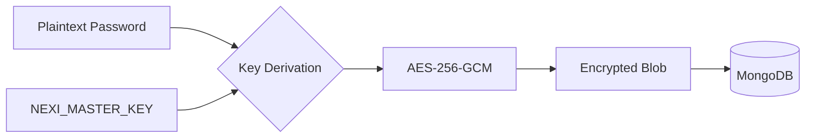

# Credential Security

> Standard Operating Procedure for managing sensitive database credentials.

## Goal
Encrypt all sensitive database credentials at rest using industry-standard AES-256-GCM encryption to prevent unauthorized access in case of database dumps or intrusion.

## Inputs
- **Master Key**: `NEXI_MASTER_KEY` environment variable (Base64 encoded 32-byte key).
- **Salt**: `NEXI_ENCRYPTION_SALT` environment variable (for key derivation).
- **Plaintext Credentials**: Database passwords provided during registration.

## Execution Scripts (Layer 3)
- `api_agents/api_gateway/services/credential_vault.py`: Encryption/Decryption service.
- `api_agents/api_gateway/scripts/rotate_keys.py`: Key rotation utility.

## Architecture

## Implementation Details
- **Algorithm**: AES-256-GCM (Galois/Counter Mode).
- **Key Derivation**: PBKDF2 with SHA256, 100,000 iterations.
- **Storage Format**: `nonce + ciphertext + tag` (Base64 encoded).

## Outputs
- **Encrypted String**: Stored in `inventory_databases` or `gateways` collections in MongoDB.

## Edge Cases
1. **Missing Master Key**:
   - System refuses to start or enters "Safe Mode" (no decryption possible).
   - Use `setup_v2.ps1` to generate dev keys.

2. **Key Rotation**:
   - When key is compromised, run `rotate_keys.py`.
   - Requires old key and new key to re-encrypt all entries.

3. **Legacy Data**:
   - Detects unencrypted fields and auto-encrypts them on first access (optional migration).

## Security Best Practices
- Never commit `.env` containing production keys.
- Rotate keys every 90 days.
- Use distinct keys for Production vs Development.
